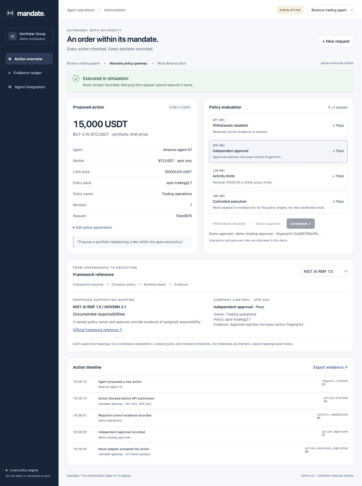
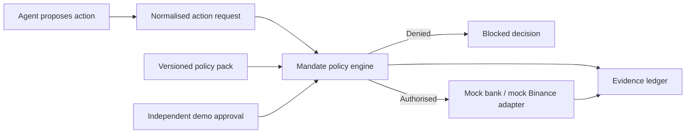

# Mandate

**The authorisation layer for AI agents.**

Mandate is a runnable hackathon prototype that checks proposed agent actions against versioned policies, routes permitted actions through mock adapters, and records decision evidence. It includes a corporate treasury agent and a Binance Spot trading agent.

All financial activity, identities, approvals and adapter responses are simulated. The policy engine runs on the server. There are no bank connections, exchange connections, API keys, external model calls or real payments.



## Run

Requires Node.js 22 or newer. No package installation, API key or database setup is needed.

```sh
git clone https://github.com/suvanshah/mandate.git
cd mandate
npm start
```

Open **http://127.0.0.1:4173**. The server binds to loopback only.

```sh
npm test         # Policy, HTTP and persistence tests
npm run check    # JavaScript syntax checks
npm run dev      # Restart server when source changes; refresh browser manually
```

`PORT` changes the default port. `MANDATE_DATA_DIR` changes the directory for local state. State and evidence are written atomically to `data/state.json`, which is excluded from Git. To start with fresh demo data, stop the server and move that directory aside.

## Present the demo in two minutes

1. **Start with the consequence:** “An AI agent can propose moving money. Who authorises the action?”
2. **Show the blocked treasury transfer:** £75,000 is blocked because beneficiary verification and independent approval are missing. Retry it to show that the server refuses execution.
3. **Show the governance link:** Select `APR-002`. The Framework reference panel connects the company rule to NIST CSF 2.0 `PR.AA-05`. Switch to NIST AI RMF to see the supporting accountability mapping.
4. **Remediate and approve:** Select Verify beneficiary, then Approve exact action. Approval records an action fingerprint, independent demo role, timestamp and policy version.
5. **Demonstrate that approval has boundaries:** Open Edit action parameters, change £75,000 to £80,000 and save. Approval is invalidated. Approve the revised action, then execute in simulation.
6. **Show the evidence:** Open Evidence ledger or export the JSON bundle. Earlier failed attempts remain visible alongside the successful simulated receipt.
7. **Switch to Binance:** The same engine loads a different policy pack and mock adapter. Disable demo withdrawal permissions, approve the exact order and execute it in simulation. The trade price is synthetic.

Pitch: **“Mandate turns agent governance into action-level authorisation and reviewable evidence.”**

## What works

- Server-side resource allowlists, action limits and independent-approval checks.
- Exact action binding: approval fingerprints include agent, action, parameters and policy version.
- Approval invalidation when parameters change.
- Policy re-evaluation immediately before execution.
- Cumulative daily trading limits across requests, using a synthetic 30,000 USDT starting exposure and a 50,000 USDT ceiling.
- At-most-once simulated execution per request ID, including repeated retries.
- Decimal-string validation and integer arithmetic for financial limits.
- Persistent request history and hash-chained decision records.
- Downloadable evidence including original failed evaluations.
- Framework references with mapping status, rationale, policy owner and official source links.
- Responsive interface, editable actions, agent switching and integration profiles.

## Architecture



- `src/engine.js`: policy evaluation, approval binding, mock execution and evidence.
- `src/server.js`: local HTTP API, static interface and atomic JSON persistence.
- `policies/packs.json`: per-agent capabilities, resource allowlists and thresholds.
- `policies/frameworks.json`: independently versioned proposed framework mappings.
- `public/`: interface with no external runtime dependencies.
- `test/`: behavioural and HTTP tests using Node's built-in test runner.

The two supported actions have explicit parameter validation. Unknown agents, unknown actions and unknown parameter keys are rejected. Adding a JSON policy entry alone does **not** enable an arbitrary new action schema or connector.

## Framework references

Mappings are proposed supporting relationships created for this prototype. A passing check does not establish compliance with a framework or standard. Monetary thresholds are company policy, not framework requirements.

| Framework | Reference | How this prototype contributes evidence |
| --- | --- | --- |
| NIST CSF 2.0 | PR.AA-05 | Restricted permissions, bounded authority and independent action approval |
| NIST AI RMF 1.0 | GOVERN 1.3 | Company risk tolerance reflected in operational limits |
| NIST AI RMF 1.0 | GOVERN 1.4 | Versioned controls and transparent decision evidence |
| NIST AI RMF 1.0 | GOVERN 2.1 | Named policy ownership and approval responsibility |
| ISO/IEC 42001:2023 | Thematic reference only | Operational risk-treatment evidence; detailed clause mapping requires review |

Sources: [NIST CSF](https://csrc.nist.gov/Projects/cybersecurity-framework/filters), [NIST AI RMF Govern](https://airc.nist.gov/airmf-resources/playbook/govern/), [ISO/IEC 42001](https://www.iso.org/standard/42001).

The Binance scenario illustrates permission separation documented in [Binance's API documentation](https://developers.binance.com/en/docs/products/spot/rest-api). It does not use or implement a live exchange integration.

## Extending Mandate to another agent

1. Register an agent identity, owner and versioned capability policy.
2. Implement strict input validation for the action schema.
3. Add resource, amount or data-sensitivity checks appropriate to that action.
4. Implement an adapter with credentials held outside the agent and a route that cannot bypass policy evaluation.
5. Define authenticated approver roles and bind approval to immutable action parameters.
6. Add framework mapping rationales and tests for blocked, approved, changed and repeated requests.

Common request shape:

```json
{
  "kind": "treasury",
  "action": "transfer.create",
  "parameters": {
    "amount": "75000.00",
    "currency": "GBP",
    "source": "acct-demo-2041",
    "destination": "beneficiary-demo-8832"
  }
}
```

## Local API

`GET /api/state` returns the demo state and a process-local anti-CSRF token. Mutation calls require this token in `X-Mandate-Token` and `Content-Type: application/json`. This is a local session boundary, **not authentication**.

| Method | Endpoint | Purpose |
| --- | --- | --- |
| GET | `/api/state` | Profiles, policy packs, requests, mapping catalogue and demo session token |
| POST | `/api/requests` | Create and initially evaluate a request |
| PUT | `/api/requests/:id` | Update parameters and invalidate approval |
| POST | `/api/requests/:id/remediate` | Simulate control remediation |
| POST | `/api/requests/:id/approve` | Simulate independent approval with the designated demo role |
| POST | `/api/requests/:id/attempt` | Re-evaluate and execute via a mock adapter if permitted |
| GET | `/api/requests/:id/evidence` | Download the request evidence and full demo ledger |

Approval actors are `demo-treasury-approver` and `demo-trading-approver`. These are deliberately simulated roles, not verified identities. If no actor is supplied to the domain treasury approval helper, it defaults to the treasury demo approver; HTTP clients should always supply the appropriate actor explicitly.

## Scope and limits

This prototype is for local presentations and engineering exploration. It is not a production financial-control system, trade-safety system, skill scanner, agent deployment scanner or certification product.

- There is no login, production RBAC, SSO, approval expiry or multi-user trust boundary. Anyone with local access can exercise the demo roles.
- A real deployment needs transactional storage, authenticated independent approvers, protected credentials, revocation, request freshness and provider idempotency/reconciliation for uncertain outcomes.
- Persistence is synchronous and intended for one local process. Do not share one data file across server processes.
- The evidence ledger is hash-chained, not signed or independently anchored. Someone controlling the whole local state file can recompute its hashes. The state projection is not verified by replaying the ledger.
- The application does not evaluate trading strategy, market conditions, financial suitability or all treasury risks. Market values and limits are illustrative.
- Daily trading usage uses UTC days and a synthetic daily baseline. Production needs explicit account, timezone, valuation, reservation and settlement semantics.
- Live connectors must prevent alternate execution paths around the gateway. Merely checking a configuration does not enforce runtime policy.

## Verification

The test suite covers both successful workflows, missing approvals, unsupported actions, wrong demo roles, changed parameters, hard limits, cross-request daily limits, duplicate execution, decimal validation, evidence alteration, HTTP mutation boundaries and state restoration. GitHub Actions runs the syntax checks and tests on pushes and pull requests.
